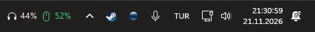

# PilGöstergesi

Kablosuz kulaklık ve mouse'ların pil seviyesini **Windows görev çubuğunun üzerinde** (gizli taşma menüsünde değil) gösteren küçük bir araç. Her cihaz için simge + yüzde çizer; şarj olurken yeşil, %15 altında kırmızı olur.

## Özellikler
- Görev çubuğuna gömülü, şeffaf widget (Shell_TrayWnd'ye bağlı katmanlı pencere)
- Sol tık menüsü: cihaz gizle/göster, şimdi yenile, Windows ile başlat, çıkış
- 10 saniyede bir ve cihaz takılınca otomatik yenileme
- Tek dosya, bağımlılık yok (sadece .NET Framework — Windows 10/11'de hazır gelir)
- Yönetici gerektirmez

## Desteklenen cihazlar
| Cihaz | Yöntem |
|---|---|
| HyperX Cloud III S kablosuz kulaklık | Vendor HID (rapor 0x0C) |
| ATK / VXE NK kablosuz mouse (NANO dongle) | ATK BITMOUSE (FF05, rapor 0x08) |
| Logitech kablosuz mouse (G Pro X Superlight vb.) | HID++ 2.0 (feature 0x1004 / 0x1000 / 0x1001) |

Yeni cihaz eklemek için `Driver` sınıfından türetip `Poller.Drivers`'a eklemek yeterli.

## Kurulum / Çalıştırma
1. `derle.bat` ile derle (Windows'taki `csc.exe`, derleme bağımlılığı yok), ya da hazır `PilGostergesi.exe`'yi çalıştır.
2. Cihaz görünmüyorsa teşhis için: `PilGostergesi.exe --test` → `test.txt` üretir.

## Nasıl çalışır
Pil değerleri, her cihazın kendi kablosuz alıcısına/dongle'ına doğrudan **salt-okunur HID** sorgularıyla okunur; hiçbir cihaza yazma yapılmaz, hiçbir veri dışarı gönderilmez. Protokol baytları açık kaynaklı projelerden referans alınarak sıfırdan yazılmıştır.

## Lisans
MIT
